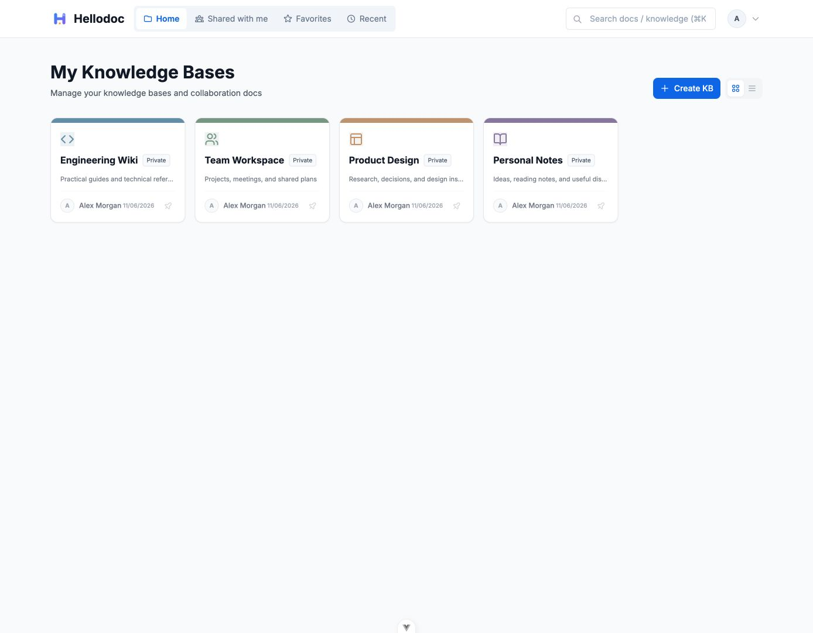
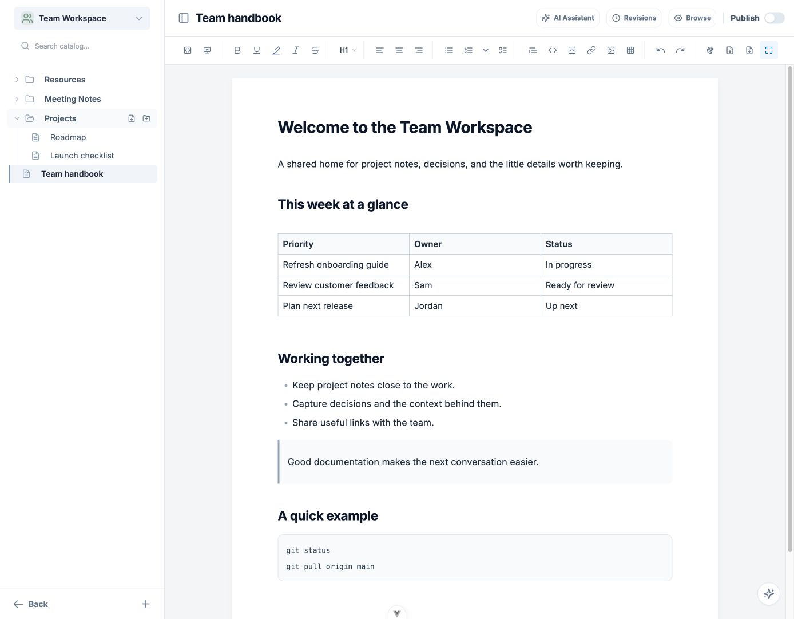

# HelloDoc

English | [简体中文](README_ZH.md)

**An AI-native, self-hosted knowledge base for your documents and the AI tools you use.**

Organize notes and team documentation in one place. Connect a compatible AI client through MCP to search and read authorized documents, help summarize information, and save results back into your knowledge base.

[Get started with Docker](#run-with-docker) · [Connect an MCP client](#connect-an-mcp-client) · [View releases](https://github.com/aladdin0414/hellodoc/releases) · [中文文档](README_ZH.md)



## From scattered notes to usable knowledge

- **Collect and organize:** create knowledge bases, arrange documents in nested folders, and find them with search. Control access with account permissions.
- **Write and collaborate:** use rich text or Markdown for notes, project documentation, tables, code, formulas, and diagrams. Share knowledge bases with collaborators.
- **Connect your AI tools:** use MCP with a compatible client to browse, search, read, create, and update authorized documents and organize folders. For example, ask your client to find related notes, summarize a discussion, and save the result in an appropriate folder.
- **Run it your way:** deploy HelloDoc with Docker and access it through the web, mobile web, or Electron desktop client. The interface supports English and Chinese.



HelloDoc can run on your own machine or server. Its built-in AI assistant requires a configured model; the model service is configured separately, so self-hosting HelloDoc does not by itself mean the model runs locally. MCP operations respect the account's permissions; available AI workflows depend on the connected client and model.

## Technology and repository layout

The frontend uses Vue 3, TypeScript, and Vite. The backend uses Java 17, Spring Boot 3, Spring Data JPA, and PostgreSQL. The desktop client uses Electron.

```text
hellodoc/
├── hellodoc-client/       Vue web frontend
├── hellodoc-server/       Spring Boot server
├── hellodoc-desktop/      Electron client
├── hellodoc-mcp-bridge/   Legacy stdio MCP bridge
├── deploy/                Docker and remote deployment configuration
├── docs/mcp-guide.md      MCP setup and tool reference
├── .env.example           Local development and remote deployment template
├── dev.sh                 Local development launcher
└── build.sh               Web and server build script
```

## Run with Docker

Docker and Docker Compose are required. This configuration runs HelloDoc and PostgreSQL.

```bash
mkdir hellodoc && cd hellodoc
curl -O https://raw.githubusercontent.com/aladdin0414/hellodoc/main/deploy/docker-compose.hub.yml
```

Create a `.env` file in the same directory and replace the placeholders:

```dotenv
DB_USERNAME=postgres
DB_PASSWORD=replace_with_a_strong_database_password
JWT_SECRET=replace_with_a_random_secret_of_at_least_64_bytes
ADMIN_PASSWORD=replace_with_a_strong_admin_password
SERVER_PORT=8080
```

PostgreSQL data is stored in `./postgres-data`. If an existing deployment used the default `uploads` directory inside the container, back up and migrate those files before changing the path or recreating the container.

```bash
docker compose -f docker-compose.hub.yml up -d
```

Open `http://localhost:8080`. The initial administrator username is `admin` and the password is the configured `ADMIN_PASSWORD`. PostgreSQL is only accessible to containers on the Compose network by default. The default image is `aladdin0414/hellodoc:latest`; set `DOCKER_IMAGE` in `.env` to select a version.

To inspect startup, run `docker compose -f docker-compose.hub.yml ps` and `docker compose -f docker-compose.hub.yml logs -f`. If port 8080 is occupied, set `SERVER_PORT` in `.env`. Generate a random JWT secret with `openssl rand -hex 64`.

Back up the database and data directories before upgrading. The server runs applicable database migrations at startup. See [Docker Hub](https://hub.docker.com/r/aladdin0414/hellodoc) and [GitHub Releases](https://github.com/aladdin0414/hellodoc/releases) for images and versions.

### Deploy directly with `docker run`

To run PostgreSQL and HelloDoc without Compose, use the following commands for a new deployment. Docker and OpenSSL are required. Run them in a new directory to keep configuration and data together:

```bash
mkdir hellodoc && cd hellodoc
mkdir -p postgres-data data logs
cat > .env <<EOF
DB_USERNAME=postgres
DB_PASSWORD=$(openssl rand -hex 24)
JWT_SECRET=$(openssl rand -hex 64)
ADMIN_PASSWORD=$(openssl rand -hex 16)
EOF
chmod 600 .env
```

Keep `.env` secure: it contains the database password, JWT secret, and initial administrator password. Create a dedicated network and start PostgreSQL:

```bash
docker network create hellodoc-net
docker run -d --name hellodoc-db --restart unless-stopped \
  --network hellodoc-net --network-alias hellodoc-db \
  --env-file .env -e POSTGRES_DB=hellodoc \
  -e POSTGRES_USER=postgres -e POSTGRES_PASSWORD="$(grep '^DB_PASSWORD=' .env | cut -d= -f2-)" \
  -v "$(pwd)/postgres-data:/var/lib/postgresql/data" postgres:15-alpine
```

Wait until the database is ready. If this command reports that it is not ready, wait and run it again:

```bash
docker exec hellodoc-db pg_isready -U postgres -d hellodoc
```

Start the application:

```bash
docker run -d --name hellodoc --restart unless-stopped \
  --network hellodoc-net --env-file .env \
  -e DB_URL=jdbc:postgresql://hellodoc-db:5432/hellodoc \
  -e FILE_UPLOAD_DIR=/app/data \
  -p 8080:8080 -v "$(pwd)/data:/app/data" -v "$(pwd)/logs:/app/logs" \
  aladdin0414/hellodoc:latest
```

Open `http://localhost:8080` and sign in as `admin` with the `ADMIN_PASSWORD` from `.env`; use `grep '^ADMIN_PASSWORD=' .env` to view the initial password. For remote access, replace `localhost` with the server address. To change the host port, adjust the first port in `-p 8080:8080`. The database, uploads, and logs persist in `postgres-data`, `data`, and `logs` in the current directory. If the container names or network already exist, inspect the existing deployment before proceeding to avoid overwriting data. The backup and restore commands below use Compose; for containers started directly, use `docker exec` to run the corresponding `pg_dump` and `pg_restore` commands.

### Backup, restore, and failed first installs

Stop writes before backing up. From the Compose directory, save `.env`, the database dump, and uploads securely:

```bash
docker compose -f docker-compose.hub.yml exec -T hellodoc-db pg_dump -U "$(grep '^DB_USERNAME=' .env | cut -d= -f2-)" -d hellodoc -Fc > hellodoc-db.dump
tar -cf hellodoc-data.tar data
```

To restore into a new empty directory, place the same Compose version and `.env` there, extract the uploads, start PostgreSQL, wait for readiness, restore the database, and start the app:

```bash
tar -xf hellodoc-data.tar
docker compose -f docker-compose.hub.yml up -d hellodoc-db
docker compose -f docker-compose.hub.yml exec -T hellodoc-db pg_isready -U postgres -d hellodoc
docker compose -f docker-compose.hub.yml exec -T hellodoc-db pg_restore -U postgres -d hellodoc --exit-on-error < hellodoc-db.dump
docker compose -f docker-compose.hub.yml up -d
```

Replace `postgres` with `DB_USERNAME` from `.env`. Retry `pg_isready` if the database is still starting. Restore only into an empty database, never directly over a production database; test recovery before upgrading.

If an old image failed on its first install with `kb_knowledge_base does not exist`, and you have confirmed that its database contains no data worth keeping, stop Compose, rename `postgres-data` as a backup, and restart with the fixed image to initialize a fresh database. If any data must be preserved, do not reset it; back it up and restore a valid backup or investigate the database first.

## Local development

Requirements: Java 17, PostgreSQL, Node.js `^20.19.0` or `>=22.12.0`, and npm. The Node.js requirement follows the Vite version used by the project.

```bash
git clone https://github.com/aladdin0414/hellodoc.git
cd hellodoc
cp .env.example .env
psql -U postgres -c "CREATE DATABASE hellodoc;"
npm ci --prefix hellodoc-client
```

Set the database connection, `JWT_SECRET`, and `ADMIN_PASSWORD` in `.env`. Configure a model if you need AI features. Start PostgreSQL, then run:

```bash
npm run dev
```

The default frontend is `http://localhost:3000`, the backend is `http://localhost:8080`, and the mobile page is `http://localhost:3000/m`. `dev.sh` terminates processes using frontend port `3000` and the configured backend port. To keep those processes, run `npm run dev:server` and `npm run dev:client` separately in terminals.

Common commands:

```bash
# Build the web frontend and server into dist/
npm run build

# Run server tests
(cd hellodoc-server && ./gradlew test)

# Run MCP Bridge tests
(cd hellodoc-mcp-bridge && npm ci && npm test)

# Start desktop development
(cd hellodoc-desktop && npm install && npm run dev)
```

`npm run build` cleans and regenerates `dist/` and the server static resources directory. See the [deployment guide](deploy/README.md) for desktop packaging and remote deployment options.

## Configuration

| Variable | Purpose |
| --- | --- |
| `DB_URL`, `DB_USERNAME`, `DB_PASSWORD` | PostgreSQL connection for local development. Docker Hub Compose sets the container's `DB_URL` itself. |
| `JWT_SECRET` | JWT signing secret; use a random value of at least 64 bytes. |
| `ADMIN_PASSWORD` | Password used when the `admin` account is first created; it does not reset an existing account. |
| `SERVER_PORT` | Local development backend or Docker Hub Compose host port; defaults to `8080`. |
| `OPENAI_API_KEY`, `OPENAI_BASE_URL`, `OPENAI_MODEL` | AI model configuration; set these for your model provider. |
| `VITE_API_TARGET`, `VITE_WS_TARGET` | API and WebSocket proxy targets for the frontend development server. |
| `HELLODOC_PUBLIC_URL` | Optional public service address for MCP document source links; Compose users must pass it into the application container. |

See [.env.example](.env.example) for the complete template and [docker-compose.hub.yml](deploy/docker-compose.hub.yml) for Compose variables.

## Connect an MCP client

Sign in to HelloDoc and create a token under **MCP access tokens** in the avatar menu. The token is displayed once and can be revoked. Clients supporting Streamable HTTP and Bearer tokens can connect to `https://your-server/api/mcp` with the token in the `Authorization` header. HTTPS is recommended.

For example, provide the token through an environment variable using a secure method, then configure Codex:

```bash
codex mcp add hellodoc --url https://docs.example.com/api/mcp --bearer-token-env-var HELLODOC_MCP_TOKEN
```

The environment variable must be available whenever Codex starts. Clients limited to stdio can use `hellodoc-mcp-bridge`. See the [MCP guide](docs/mcp-guide.md) for permissions, pagination, concurrency conflicts, and retry behavior.

## License

[MIT License](LICENSE)
