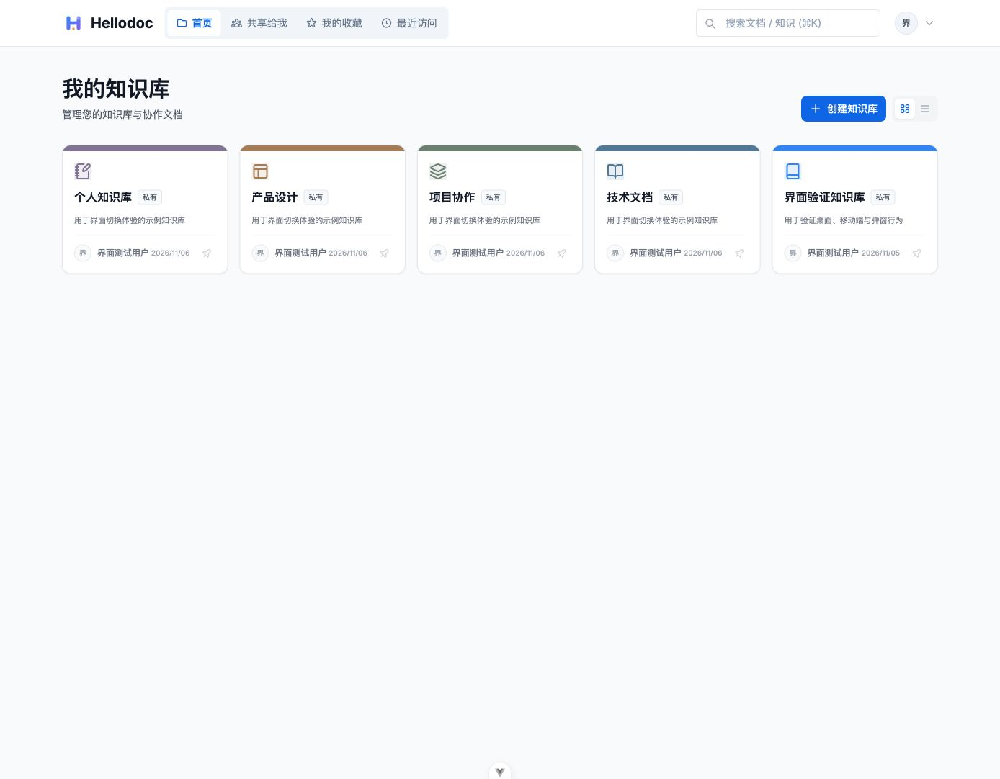
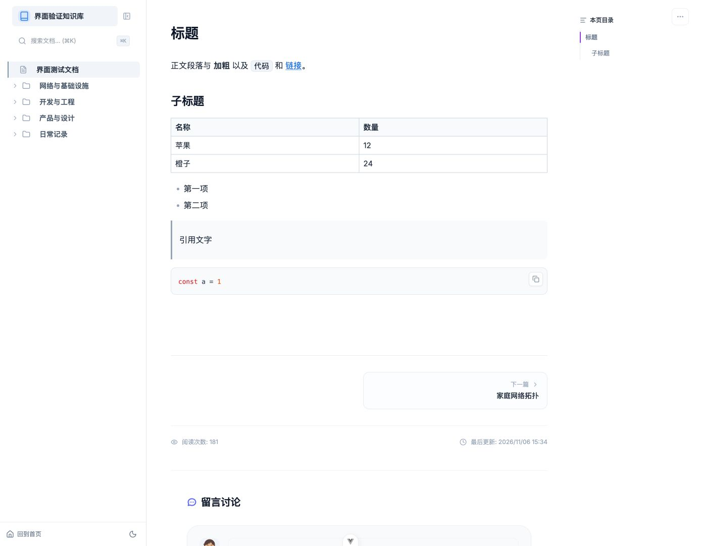

# HelloDoc

[English](README.md) | 简体中文

**AI Native 自部署知识库，让文档和 AI 工具在同一个知识体系中协作。**

把个人笔记和团队文档整理到自己的知识库中。通过 MCP 连接兼容的 AI 客户端，在账号权限范围内检索、读取文档，辅助汇总信息，并将结果保存回知识库。

[使用 Docker 部署](#使用-docker-镜像) · [连接 MCP 客户端](#mcp-接入) · [查看版本](https://github.com/aladdin0414/hellodoc/releases) · [English](README.md)



## 从零散笔记到可用知识

- **收集与分类：**创建知识库，用多级文件夹组织文档，通过搜索查找资料，并使用账号权限控制访问范围。
- **写作与协作：**使用富文本或 Markdown 编写笔记和项目文档，支持表格、代码、公式及图表，并可与协作成员共享知识库。
- **连接 AI 工具：**通过 MCP 让兼容客户端浏览、搜索、读取、创建和更新有权限的文档，以及整理文件夹。例如，让客户端查找相关笔记、汇总讨论内容，并将结果保存到合适的目录。
- **自主部署与多端访问：**使用 Docker 部署 HelloDoc，通过 Web、移动端页面或 Electron 桌面客户端访问，界面支持中英文。



HelloDoc 可以部署在自己的电脑或服务器上。内置 AI 助手需要配置模型；模型服务单独配置，因此自部署 HelloDoc 并不意味着模型一定在本地运行。MCP 操作受账号权限控制，具体 AI 工作流还取决于所连接的客户端和模型。

## 技术栈与项目结构

前端使用 Vue 3、TypeScript 和 Vite；后端使用 Java 17、Spring Boot 3、Spring Data JPA 和 PostgreSQL。桌面客户端使用 Electron。

```text
hellodoc/
├── hellodoc-client/       Vue Web 前端
├── hellodoc-server/       Spring Boot 服务端
├── hellodoc-desktop/      Electron 客户端
├── hellodoc-mcp-bridge/   旧版 stdio MCP 桥接程序
├── deploy/                Docker 和远程部署配置
├── docs/mcp-guide.md      MCP 接入和工具说明
├── .env.example           本地开发及远程部署配置模板
├── dev.sh                 本地开发启动脚本
└── build.sh               Web 与服务端构建脚本
```

## 使用 Docker 镜像

需要 Docker 和 Docker Compose。以下配置运行 HelloDoc 和 PostgreSQL。

```bash
mkdir hellodoc && cd hellodoc
curl -O https://raw.githubusercontent.com/aladdin0414/hellodoc/main/deploy/docker-compose.hub.yml
```

在同一目录创建 `.env`，替换下面的占位值：

```dotenv
DB_USERNAME=postgres
DB_PASSWORD=replace_with_a_strong_database_password
JWT_SECRET=replace_with_a_random_secret_of_at_least_64_bytes
ADMIN_PASSWORD=replace_with_a_strong_admin_password
SERVER_PORT=8080
```

PostgreSQL 数据保存在 `./postgres-data`。已有部署如果此前使用默认的容器内 `uploads` 目录，应先备份并迁移现有上传文件，再切换路径或重建容器。

```bash
docker compose -f docker-compose.hub.yml up -d
```

访问 `http://localhost:8080`。首次初始化的管理员用户名为 `admin`，密码为配置的 `ADMIN_PASSWORD`。PostgreSQL 默认只对 Compose 网络内的容器开放，不映射到宿主机。镜像默认使用 `aladdin0414/hellodoc:latest`，也可在 `.env` 中设置 `DOCKER_IMAGE` 指定版本。

可用 `docker compose -f docker-compose.hub.yml ps` 查看状态，使用 `docker compose -f docker-compose.hub.yml logs -f` 查看日志。若 8080 端口被占用，在 `.env` 中修改 `SERVER_PORT`。可用 `openssl rand -hex 64` 生成随机 JWT 密钥。

升级前请备份数据库和数据目录；服务启动时会执行相应数据库迁移。镜像及版本见 [Docker Hub](https://hub.docker.com/r/aladdin0414/hellodoc) 和 [GitHub Releases](https://github.com/aladdin0414/hellodoc/releases)。

### 使用 `docker run` 直接部署

不使用 Compose 时，可以直接运行 PostgreSQL 和 HelloDoc 容器。以下命令适用于全新部署，需要 Docker 和 OpenSSL；在新目录中执行，以保存配置和数据：

```bash
mkdir hellodoc && cd hellodoc
mkdir -p postgres-data data logs
cat > .env <<EOF
DB_USERNAME=postgres
DB_PASSWORD=$(openssl rand -hex 24)
JWT_SECRET=$(openssl rand -hex 64)
ADMIN_PASSWORD=$(openssl rand -hex 16)
EOF
chmod 600 .env
```

`.env` 包含数据库密码、JWT 密钥和初始管理员密码，请妥善保存。创建专用网络并启动数据库：

```bash
docker network create hellodoc-net
docker run -d --name hellodoc-db --restart unless-stopped \
  --network hellodoc-net --network-alias hellodoc-db \
  --env-file .env -e POSTGRES_DB=hellodoc \
  -e POSTGRES_USER=postgres -e POSTGRES_PASSWORD="$(grep '^DB_PASSWORD=' .env | cut -d= -f2-)" \
  -v "$(pwd)/postgres-data:/var/lib/postgresql/data" postgres:15-alpine
```

等待数据库就绪；如果命令提示尚未就绪，稍等后重新执行：

```bash
docker exec hellodoc-db pg_isready -U postgres -d hellodoc
```

启动应用：

```bash
docker run -d --name hellodoc --restart unless-stopped \
  --network hellodoc-net --env-file .env \
  -e DB_URL=jdbc:postgresql://hellodoc-db:5432/hellodoc \
  -e FILE_UPLOAD_DIR=/app/data \
  -p 8080:8080 -v "$(pwd)/data:/app/data" -v "$(pwd)/logs:/app/logs" \
  aladdin0414/hellodoc:latest
```

访问 `http://localhost:8080`，使用用户名 `admin` 和 `.env` 中的 `ADMIN_PASSWORD` 登录；可用 `grep '^ADMIN_PASSWORD=' .env` 查看初始密码。远程访问时将 `localhost` 替换为服务器地址；如需修改宿主机端口，请调整 `-p 8080:8080` 的第一个端口。数据库、上传文件和日志分别保存在当前目录的 `postgres-data`、`data` 和 `logs` 中。容器名称或网络已存在时，请先检查现有部署，避免覆盖数据。下面的备份和恢复命令使用 Compose；直接运行的容器需要用 `docker exec` 执行相应的 `pg_dump` 和 `pg_restore`。

### 备份、恢复与失败首装修复

备份前停止写入；以下命令在 Compose 文件所在目录运行。保存 `.env`、数据库备份和 `data` 目录，并妥善保护其中的密钥和文件：

```bash
docker compose -f docker-compose.hub.yml exec -T hellodoc-db pg_dump -U "$(grep '^DB_USERNAME=' .env | cut -d= -f2-)" -d hellodoc -Fc > hellodoc-db.dump
tar -cf hellodoc-data.tar data
```

恢复到新的空目录时，放入同版本 Compose 和 `.env`，先解压 `data`，启动数据库，等待其就绪后恢复，再启动应用：

```bash
tar -xf hellodoc-data.tar
docker compose -f docker-compose.hub.yml up -d hellodoc-db
docker compose -f docker-compose.hub.yml exec -T hellodoc-db pg_isready -U postgres -d hellodoc
docker compose -f docker-compose.hub.yml exec -T hellodoc-db pg_restore -U postgres -d hellodoc --exit-on-error < hellodoc-db.dump
docker compose -f docker-compose.hub.yml up -d
```

示例中的 `postgres` 应替换为 `.env` 中的 `DB_USERNAME`；如数据库尚未就绪，请稍等后重试 `pg_isready`。恢复前确保目标数据库为空，切勿向现有生产库直接执行恢复。升级前应先演练恢复。

如果旧镜像首次安装失败，日志包含 `kb_knowledge_base does not exist`，且确认该数据库从未保存需要保留的数据，可停止 Compose，将 `postgres-data` 重命名备份，再用修复后的镜像重新启动，让它创建空数据库。若已有任何需要保留的数据，请勿重置，先备份并从有效备份恢复或排查数据库状态。

## 本地开发

需要 Java 17、PostgreSQL 和 Node.js `^20.19.0` 或 `>=22.12.0`，以及 npm。前端 Node.js 版本要求来自项目使用的 Vite。

```bash
git clone https://github.com/aladdin0414/hellodoc.git
cd hellodoc
cp .env.example .env
psql -U postgres -c "CREATE DATABASE hellodoc;"
npm ci --prefix hellodoc-client
```

修改 `.env` 中的数据库连接、`JWT_SECRET` 和 `ADMIN_PASSWORD`。如果需要 AI 模型，填写相应模型配置。启动前确保 PostgreSQL 正在运行：

```bash
npm run dev
```

默认前端地址为 `http://localhost:3000`，后端地址为 `http://localhost:8080`，移动端页面为 `http://localhost:3000/m`。`dev.sh` 会终止占用前端 `3000` 和配置的后端端口的进程；如果需要保留这些进程，请分别在终端中运行 `npm run dev:server` 和 `npm run dev:client`。

常用命令：

```bash
# 构建 Web 和服务端，产物输出到 dist/
npm run build

# 服务端测试
(cd hellodoc-server && ./gradlew test)

# MCP Bridge 测试
(cd hellodoc-mcp-bridge && npm ci && npm test)

# 桌面客户端开发
(cd hellodoc-desktop && npm install && npm run dev)
```

`npm run build` 会清理并重新生成 `dist/` 与服务端静态资源目录。桌面端打包和远程部署选项见 [部署指南](deploy/README.md)。

## 主要配置

| 变量 | 用途 |
| --- | --- |
| `DB_URL`、`DB_USERNAME`、`DB_PASSWORD` | 本地服务使用的 PostgreSQL 连接信息。Docker Hub Compose 自行设置容器内 `DB_URL`。 |
| `JWT_SECRET` | JWT 签名密钥，建议使用至少 64 字节的随机值。 |
| `ADMIN_PASSWORD` | 初次创建 `admin` 账号时使用的密码；已有账号不会因此重置密码。 |
| `SERVER_PORT` | 本地开发后端或 Docker Hub Compose 对外端口，默认 `8080`。 |
| `OPENAI_API_KEY`、`OPENAI_BASE_URL`、`OPENAI_MODEL` | AI 模型相关配置；按实际模型服务填写。 |
| `VITE_API_TARGET`、`VITE_WS_TARGET` | 前端开发服务器的 API 和 WebSocket 代理地址。 |
| `HELLODOC_PUBLIC_URL` | 可选的公开服务地址，用于生成 MCP 文档来源链接；Compose 部署时需将该变量传入应用容器。 |

完整模板见 [.env.example](.env.example)，Compose 部署可用变量见 [docker-compose.hub.yml](deploy/docker-compose.hub.yml)。

## MCP 接入

登录 HelloDoc，在头像菜单的 **MCP 访问令牌**中创建令牌。令牌只在创建时显示一次，可随时撤销。支持 Streamable HTTP 和 Bearer 令牌的客户端可连接 `https://你的服务地址/api/mcp`，并在 `Authorization` 请求头中提供令牌。建议使用 HTTPS。

例如，先通过安全方式将令牌放入环境变量，再配置 Codex：

```bash
codex mcp add hellodoc --url https://docs.example.com/api/mcp --bearer-token-env-var HELLODOC_MCP_TOKEN
```

每次启动 Codex 时需提供该环境变量。旧版仅支持 stdio 的客户端可使用 `hellodoc-mcp-bridge`。详细的权限、分页、并发冲突和重试行为见 [MCP 接入指南](docs/mcp-guide.md)。

## 许可证

[MIT License](LICENSE)
